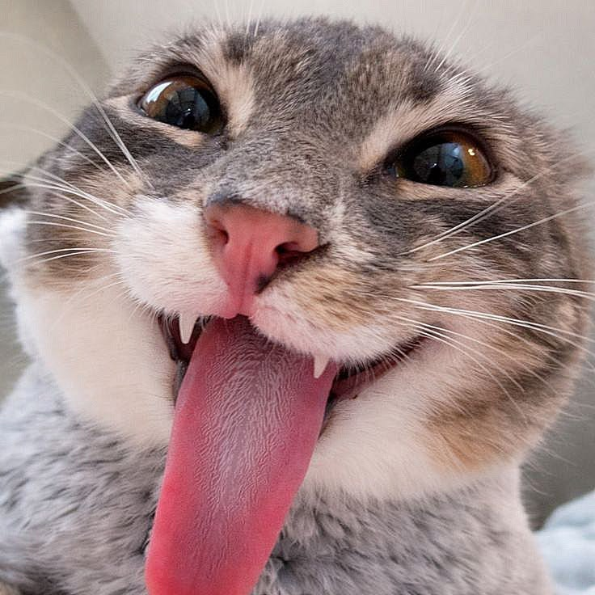
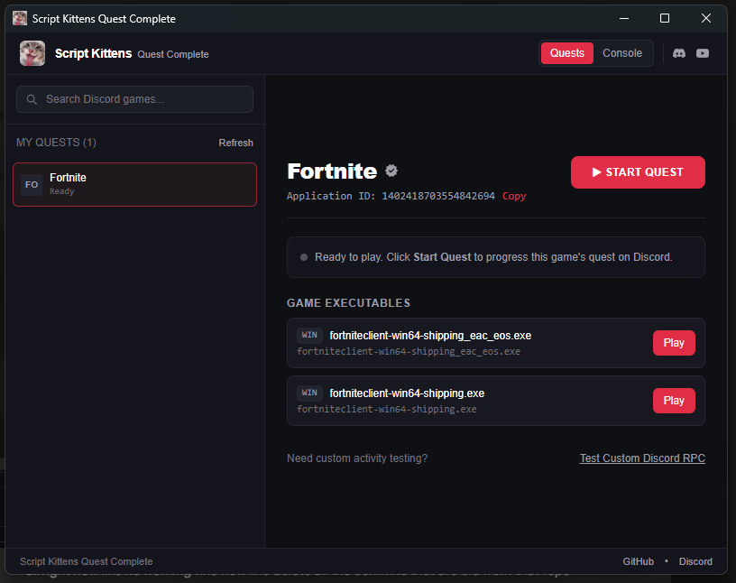

<p align="center">
  
</p>

<h1 align="center">Script Kittens Quest Complete</h1>

<p align="center">
  <b>Finish Discord quests in minutes without downloading multi-gigabyte games.</b><br/>
  Search any Discord-verified game, hit <b>Play</b>, and let Discord think you're in-game
  while a tiny portable dummy process does the work.
</p>

<p align="center">
  
  
  
  
</p>

<p align="center">
  <a href="https://www.youtube.com/@1shot1moanz">YouTube</a> •
  <a href="https://discord.gg/2v9F7bp94F">Discord</a> •
  <a href="https://script-kittens.com">Website</a> •
  <a href="https://github.com/ScriptKittenss/Discord-Quest-Completer">GitHub</a>
</p>

---

## Preview

<p align="center">
  
</p>

## Why this exists

Discord quests require you to play or stream a specific game for 15 minutes to earn badges and rewards. Many of these games are 40 GB+ downloads. **Script Kittens Quest Complete** bypasses the need to download the games by simulating their registered application status with a lightweight background runner process that matches the official game ID.

## Features

- **Instant Game Search** — Fast fuzzy search through 25,000+ Discord-verified detectable games. The game list ships inside the app, so search is ready in seconds — no waiting on a download.
- **One-Click Dummy Generation** — Emulates official executables with real Discord Application IDs.
- **Dark Script Kittens UI** — Clean dark-red interface with Plus Jakarta Sans typography.
- **Live Quest Status & Timer** — Tracks elapsed simulation time in the header and displays Discord profile status preview.
- **Diagnostic Console** — Test custom Discord RPC activities and view real-time process stdout/stderr event streams.
- **Zero Disk Footprint** — Fully portable, runs without cluttering system files.

## How it works

1. Open **Script Kittens Quest Complete**.
2. Search for the game tied to your Discord quest (e.g. *Where Winds Meet*, *Deadlock*, *Warframe*).
3. Click **+ Add to Quests**.
4. In the Quest Control panel, click **Start Quest**.
5. Discord detects you as playing the game and starts progressing your quest.
6. Once completed, click **Stop Quest**.

## Download

Grab the latest build from the [Releases](https://github.com/ScriptKittenss/Discord-Quest-Completer/releases) page — a portable `.exe`, no install needed. Unzip and run it (keep the `data` folder next to the exe — it holds the runner the quests need).

> **Notice:** Raw source code downloads do not include pre-compiled runner binaries or offline game registries. To run the application, use the release builds from GitHub Releases or compile via the build pipeline below.

## Building from source

Requirements:
- [Node.js](https://nodejs.org/) (v20+)
- [pnpm](https://pnpm.io/)
- [Rust](https://rustup.rs/) (stable-x86_64-pc-windows-msvc)
- Visual Studio C++ Build Tools

```bash
# 1. Install frontend dependencies
pnpm install

# 2. Generate multi-resolution icons
pnpm run icons

# 3. Compile Windows background runner
pnpm run build:runner:win
pnpm run copy:runner:win

# 4. Build application & installer bundles
pnpm run build
pnpm tauri build
```

## Credits

Maintained and redesigned by **[Script Kittens](https://github.com/ScriptKittenss)** • [script-kittens.com](https://script-kittens.com).
